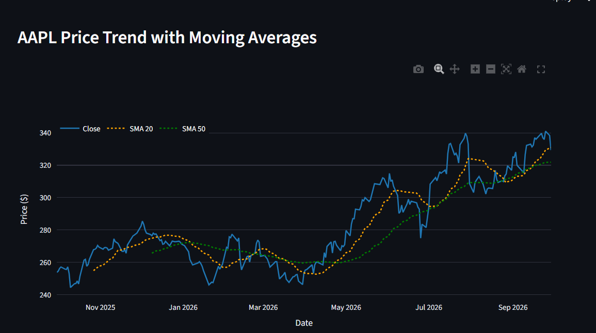
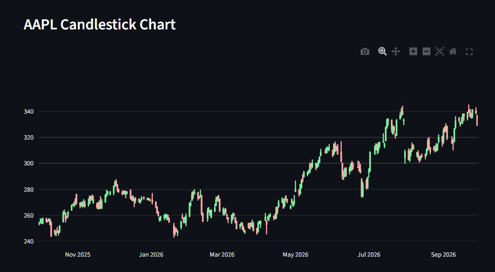
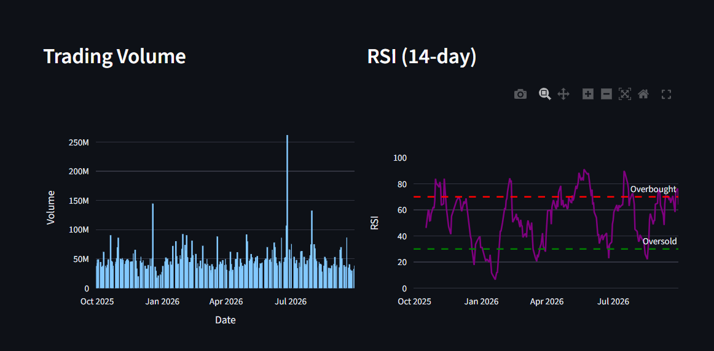
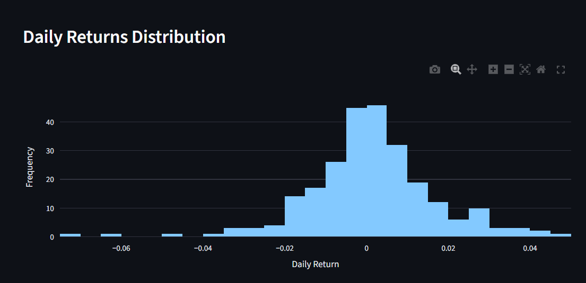
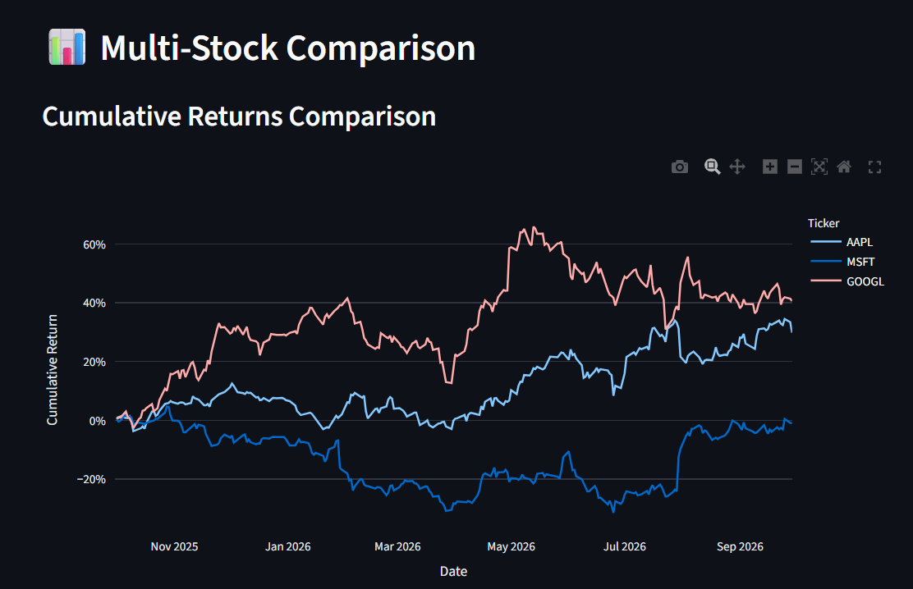
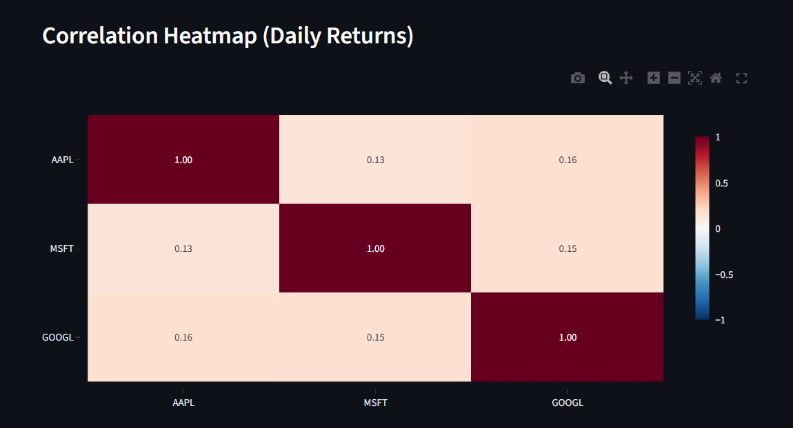
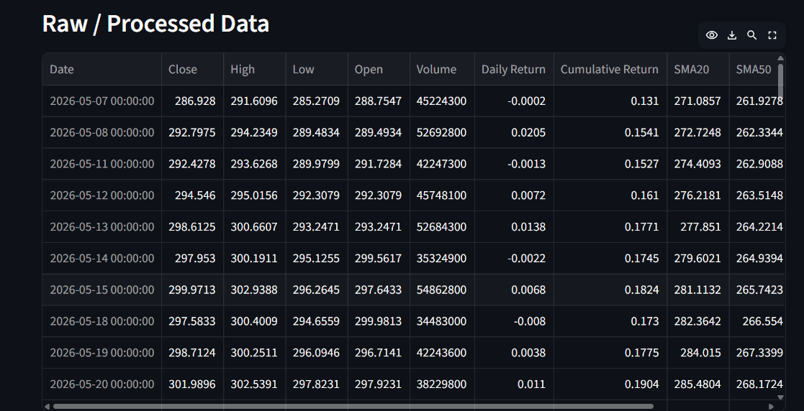

# 📈 Stock Market Analytics Dashboard

An interactive **Stock Market Analytics Dashboard** built with Python and Streamlit for exploring historical market data, technical indicators, returns, trading volume, and relationships between multiple stocks.

The application fetches market data from **Yahoo Finance**, processes it using **Pandas and NumPy**, and presents the results through interactive **Plotly** visualizations.

> **Disclaimer:** This project is intended for educational and portfolio purposes only. It is not financial advice or an investment recommendation.

---

## 📌 Project Overview

The Stock Market Analytics Dashboard provides an interactive interface for analyzing one or multiple stock tickers over a selected time period.

Users can:

- Enter one or multiple stock tickers
- Select the analysis period and data interval
- Choose a primary ticker for detailed analysis
- Analyze price trends and moving averages
- View OHLC candlestick charts
- Analyze trading volume
- Monitor the 14-day RSI
- Study the distribution of daily returns
- Compare cumulative returns across multiple stocks
- Analyze correlations between stock returns
- View processed market data
- Download processed data as a CSV file

The project combines **data collection, preprocessing, financial time-series analysis, and interactive visualization** into a single dashboard.

---

## ✨ Features

### 📊 Price Trend & Moving Averages

Displays the selected stock's closing price along with:

- **SMA 20** — 20-day Simple Moving Average
- **SMA 50** — 50-day Simple Moving Average

This provides a visual way to examine price movement and moving-average trends.

### 🕯️ Candlestick Chart

Interactive OHLC candlestick visualization showing:

- Open
- High
- Low
- Close

Plotly controls allow users to zoom, pan, and inspect different sections of the chart.

### 📦 Trading Volume

Displays historical trading volume using an interactive bar chart, making changes in market activity easier to observe.

### 📈 RSI (14-day)

Calculates and displays the **14-day Relative Strength Index (RSI)**.

The dashboard includes reference levels:

- **70** — Overbought reference
- **30** — Oversold reference

### 📉 Daily Returns Distribution

Displays a histogram of daily percentage returns to visualize the distribution of the stock's day-to-day price changes.

### 📊 Multi-Stock Comparison

When multiple tickers are entered, the dashboard compares their **cumulative returns** over the selected period.

Example:

```text
AAPL, MSFT, GOOGL
```

### 🔗 Correlation Heatmap

Calculates correlations between the daily returns of multiple selected stocks and displays them using an interactive heatmap.

### 🗃️ Raw / Processed Data

The dashboard provides a table containing market data and calculated analytics such as:

- Date
- Open
- High
- Low
- Close
- Volume
- Daily Return
- Cumulative Return
- SMA20
- SMA50
- Volatility
- RSI

### 💾 CSV Export

Processed data can be downloaded directly from the dashboard as a CSV file for further analysis.

---

## 📸 Screenshots

### Price Trend with Moving Averages



### Candlestick Chart



### Trading Volume & RSI



### Daily Returns Distribution



### Multi-Stock Comparison



### Correlation Heatmap



### Raw / Processed Data



> The screenshots above show an example analysis using AAPL and a multi-stock comparison using AAPL, MSFT, and GOOGL.

---

## 🛠️ Tech Stack

| Technology | Purpose |
|---|---|
| **Python** | Core programming language |
| **Streamlit** | Interactive web application |
| **yfinance** | Fetching Yahoo Finance market data |
| **Pandas** | Data manipulation and preprocessing |
| **NumPy** | Numerical calculations |
| **Plotly** | Interactive charts and visualizations |

---

## 📐 Analytics Implemented

### Daily Return

Daily percentage return is calculated as:

```text
Daily Return = (Today's Close / Previous Close) - 1
```

### Cumulative Return

Cumulative return is calculated from the sequence of daily returns:

```text
Cumulative Return = Product(1 + Daily Return) - 1
```

### Simple Moving Average

The dashboard calculates two moving averages:

```text
SMA20 = 20-period rolling mean
SMA50 = 50-period rolling mean
```

### Annualized Volatility

The project estimates annualized volatility using a 20-period rolling standard deviation:

```text
Annualized Volatility = Rolling Standard Deviation × √252
```

### Relative Strength Index

A 14-period RSI is calculated using rolling gains and losses to measure recent price momentum.

---

## 📁 Project Structure

```text
stock-market-analytics-dashboard/
│
├── app.py
├── README.md
├── requirements.txt
├── .gitignore
│
└── screenshots/
    ├── price-trend.png
    ├── candlestick.png
    ├── volume-rsi.png
    ├── daily-returns.png
    ├── multi-stock-comparison.png
    ├── correlation-heatmap.png
    └── data-table.png
```

---

## ⚙️ Installation

### 1. Install Python

Python 3.9+ is recommended.

Check your Python version:

```bash
python --version
```

### 2. Clone the repository

```bash
git clone https://github.com/YOUR-USERNAME/stock-market-analytics-dashboard.git
```

### 3. Open the project directory

```bash
cd stock-market-analytics-dashboard
```

### 4. Create a virtual environment

```bash
python -m venv venv
```

### 5. Activate the virtual environment

#### Windows PowerShell

```powershell
venv\Scripts\activate
```

#### Windows Command Prompt

```cmd
venv\Scripts\activate
```

#### macOS / Linux

```bash
source venv/bin/activate
```

### 6. Install dependencies

```bash
pip install -r requirements.txt
```

---

## ▶️ How to Run

Start the Streamlit application:

```bash
python -m streamlit run app.py
```

Streamlit will provide a local URL in the terminal. Usually:

```text
http://localhost:8501
```

Open that address in your browser if the dashboard does not open automatically.

---

## 🎯 How to Use the Dashboard

### Step 1 — Enter Stock Tickers

Enter one or more ticker symbols in the sidebar.

For example:

```text
AAPL, MSFT, GOOGL
```

Other examples include:

```text
TSLA, NVDA, AMZN
```

### Step 2 — Select Date Range

Choose the historical period you want to analyze.

### Step 3 — Select Data Interval

Choose the required interval, such as:

```text
1d
1wk
1mo
```

### Step 4 — Select Primary Ticker

Select one ticker as the **primary ticker** for the detailed single-stock charts.

When multiple tickers are provided, the dashboard automatically displays:

- Cumulative returns comparison
- Correlation heatmap

---

## ⚡ Data Processing

The application performs several preprocessing steps before analysis:

1. Downloads market data using `yfinance`
2. Handles the downloaded DataFrame structure
3. Removes rows containing only missing values
4. Fills missing values using forward and backward filling
5. Calculates returns and technical indicators
6. Generates interactive visualizations
7. Provides the processed dataset for viewing and download

The application also uses Streamlit caching to reduce repeated data-fetching requests during the same analysis session.

---

## 🚀 Future Improvements

The dashboard can be extended with additional analytics and application features.

### 📊 Additional Financial Metrics

- Sharpe Ratio
- Maximum Drawdown
- Beta
- 52-week High / Low
- Average Daily Return
- Risk-adjusted performance metrics

### 📈 More Technical Indicators

Possible additions include:

- EMA
- MACD
- Bollinger Bands
- ATR
- Stochastic Oscillator

### 🔔 Price & Indicator Alerts

Add configurable alerts for:

- Price crossing SMA20
- Price crossing SMA50
- RSI above 70
- RSI below 30
- Large daily price movements

### 🗄️ Database Integration

Store historical market data using:

- SQLite
- MySQL
- PostgreSQL

This could reduce repeated API requests and provide a persistent historical dataset.

### 💼 Portfolio Analysis

Possible portfolio features include:

- Portfolio allocation
- Portfolio return
- Portfolio volatility
- Risk analysis
- Portfolio performance comparison

### 🧪 Backtesting

Add a framework for testing simple technical-indicator-based strategies on historical data.

### ☁️ Deployment

Deploy the Streamlit dashboard as a publicly accessible web application using a suitable cloud hosting platform.

---

## 📚 Learning Outcomes

This project provides practical experience with:

- Python application development
- Financial time-series data
- API-based data collection
- Pandas data manipulation
- NumPy numerical calculations
- Data preprocessing
- Technical indicators
- Statistical analysis
- Interactive Plotly visualizations
- Streamlit dashboard development
- Multi-stock comparison
- Correlation analysis
- CSV data export

---

## ⚠️ Disclaimer

This project is created for **educational and portfolio purposes only**.

The data and analytics displayed by the application should not be considered financial advice, investment advice, or a recommendation to buy or sell any security.

---

## 👨‍💻 Author

**Abhisek Raj**

Mechanical Engineering  
IIT Patna
